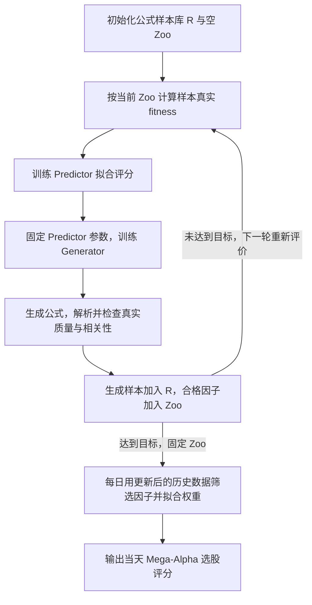

# AlphaForge 论文解读

> - 速读卡：[AlphaForge](../cards/2024_AlphaForge.md)
> - 文献版本：[arXiv v5](https://arxiv.org/html/2406.18394v5)，2024-12-12
> - 文献范围：正文及附录 A 的作者检查表；正文另行提及的补充材料未纳入本文证据。

## 核心结论

AlphaForge 将公式因子挖掘与动态组合划分为两个阶段。挖掘阶段采用生成器—预测器模型，生成具有预测能力且相互低相关的公式，形成 Factor Zoo；组合阶段根据因子的近期表现，每日更新因子子集与线性组合权重，构建选股信号 Mega-Alpha。两阶段分别针对稀疏评分下的搜索效率和因子有效性的时变特征。论文在 CSI300、CSI500 上报告了预测指标的改善，动态与静态组合的对照为组合阶段的增量作用提供了实验依据。

## 1. 研究背景与问题

公式因子以历史量价数据为输入，为股票截面输出预测未来收益的评分。本文使用开盘价、最高价、最低价、收盘价、成交量与 VWAP 六个字段及其历史窗口。多个因子经组合形成最终选股信号，论文将其称为 Mega-Alpha（原文 Preliminary）。

论文关注因子挖掘与组合使用中的两类相关问题。

第一，公式表达空间庞大，满足质量与相关性要求的有效候选稀少。候选必须完整生成并在行情数据上求值，才能获得预测能力评价；大量零分候选使直接采样难以获得有效的搜索方向。作者因此引入神经网络学习高分公式的分布，同时保留公式表达的可解释性（原文 Introduction、Factor Mining Model）。

第二，固定因子集合与固定权重难以适应因子有效性的变化。论文讨论的 RL 参照方法联合进行因子挖掘与组合权重学习，最终使用固定组合；市场风格变化则可能导致部分因子失效或预测方向反转。扩大候选集合本身不能解决因子启用时点与组合权重的动态调整问题（原文 Introduction、Alpha Combination）。

由此，论文将研究目标分为有效公式的定向生成，以及基于时变表现的因子筛选与组合。

## 2. 核心思路：代理引导生成与动态组合

两阶段设计分别对应搜索目标稀疏与因子表现非平稳这两类困难。

挖掘阶段采用可微预测器近似真实评分函数。真实评分依赖公式执行、IC 计算及候选与已有因子的相关性。Predictor 以已评价公式为监督样本，学习上述评分关系；Generator 通过预测评分获得梯度信号，无需对真实 IC 计算直接求导。多样性损失进一步约束生成分布，缓解候选集中于少数模式的问题（原文 Factor Mining Model）。

使用阶段从固定候选库中动态筛选因子并估计组合权重。基于因子表现可能具有动量、同时存在失效与反转风险的判断，组合器利用更新后的历史数据重评各因子。Factor Zoo 在使用阶段保持不变，每日参与组合的因子子集与权重则随近期表现调整（原文 Alpha Combination、Overview）。

该设计将候选库构建与日常组合决策解耦：前者负责生成可供选择的公式集合，后者在固定集合内调整使用方式。

## 3. 方法设计

### 3.1 总体框架与迭代关系

框架包含公式样本库、准入因子库与每日使用子集三个对象：

| 对象 | 含义 | 作用 |
| --- | --- | --- |
| 样本库 R | 用于评价与训练的公式样本 | 为 Predictor 提供公式与真实评分的监督样本 |
| 因子库 Z，即 Factor Zoo | 通过质量与相关性准入的公式 | 为组合阶段提供候选 |
| 每日子集 Z_t^{(N)} | 从固定 Zoo 中选出的至多 N 个因子 | 参与当天的 Mega-Alpha |

样本库包含未通过准入的生成公式，用于积累评分信息；Zoo 仅保留合格因子，作为组合阶段的候选集合。两者的更新共同影响后续搜索，具体关系如下（原文 Figure 1、Algorithm 1）：



图中表示外层迭代关系。每轮内部包含多次噪声采样、Generator 更新与候选评价。生成公式扩充样本库，新增准入因子改变相关性筛选条件，因而下一轮需要依据当前 Zoo 重新评价样本并训练 Predictor。Zoo 达到目标规模后，挖掘阶段结束，其结果作为组合阶段的固定输入（原文 Algorithm 1、Overview）。

### 3.2 适应度定义与因子准入

论文用 IC 衡量因子的平均截面预测能力：

```text
IC(f, X, Y) = (1/T) * sum_{t=1..T} ρ(f(X_t), y_t)  （式 1）
```

其中 T 是评价交易日数，X_t 是时点 t 的历史特征，f(X_t) 是各股票的因子值，y_t 是对应未来收益，ρ 是截面 Pearson 相关。IC 衡量因子值与未来收益的平均截面线性关联，公式表达式与公式在行情上产生的数值应分开理解。

对编码为 x、解析后为 f 的公式，论文的 fitness 为：

```text
π(x, Z, X, Y) = |IC(f, X, Y)|，当 f 合法且 ψ(f, Z, X, Y) < CORR'
π(x, Z, X, Y) = 0，其他情况  （式 5）
```

ψ 表示候选与已有 Zoo 中因子的最大绝对相关，CORR' 是相关性阈值。取绝对 IC 的理由是负向预测信号可以反向使用。原文还说明，因子准入依据 IC、用于稳定性筛选的 ICIR 与收益相关性三类条件；式 (5) 是训练评分的定义，不能单独代替 Algorithm 1 中全部 `qualified` 准入条件。

该评分同时约束预测能力与因子冗余。同一公式在 Zoo 为空时可能获得非零评分，在相似因子准入后则可能因相关性条件不满足而得零分。因此，Algorithm 1 在每轮开始依据当前 Zoo 重新评价样本库。此处的目标变化由因子库状态引起，应与组合阶段针对市场变化的动态调整区分。

### 3.3 基于代理模型的可微公式生成

论文将表达式树转成逆波兰记法（RPN，即按后序顺序排列操作数与算子），再编码为 D × S 的 one-hot 二值矩阵 x。D 是可用 token 的维度，S 是最大公式长度。这使公式本身能够成为神经网络的输入或输出（原文 Formulaic Alpha）。

Predictor 以公式编码为输入，估计对应的 fitness。其监督标签来自上一节定义的真实评价过程；该模型拟合公式与评分的映射，不直接预测股票收益。训练目标为：

```text
L_P = sqrt((1/n) * sum_{i=1..n} (P(x_i) - fitness(x_i))^2)  （式 2）
```

其中 n 为 Predictor 的训练样本数。上式保留论文的公式形式，训练所得预测器为真实评分函数提供可微近似。

Generator 以正态噪声 z 为输入，输出各位置的 token logits，经变换 M 得到公式编码。其目标为最大化 Predictor 对生成公式的预测评分：

```text
x = M(G(z))
L_Fitness = -P(M(G(z)))  （式 3）
```

M 包含序列规则掩码与 Gumbel-Softmax：前者约束公式语法，后者提供离散选择的可微近似。训练 Generator 时固定 Predictor 的参数，梯度经过 P 和 M 回传到 G；真实 IC 计算不在这条梯度路径上（原文 Factor Mining Model）。

代理模型由此将候选评价信息转化为生成器可利用的局部梯度信号。由于代理预测存在误差，生成公式仍须经过解析、真实评价与准入筛选，不能仅凭预测评分进入 Zoo。

### 3.4 生成多样性与因子去冗余

仅优化预测评分可能导致生成分布集中于少数高分模式。论文通过两次噪声采样生成两组候选，并分别对 one-hot 编码与隐藏表示的相似度施加惩罚。式 (4) 的目标结构可概括为：

```text
L_G = -P(x_1) + L_Diversity  （式 4）
```

其中多样性项由 one-hot 相似度和隐藏表示相似度加权组成。该约束使生成目标同时考虑预测评分与候选差异，完整相似度记号见原式 (4)。所据正文未展开两个相似度函数的具体计算形式，因而此处仅分析其约束作用。

生成多样性约束作用于候选分布，准入相关性约束则作用于候选与已有因子的行为冗余。表达结构或表示差异不必然对应行情上的低相关性，因此两类约束具有不同作用，不能相互替代（依据原文机制的分析）。

### 3.5 基于近期表现的动态因子组合

挖掘完成后，Factor Zoo 保持固定。组合器在各预测时点依据此前历史数据重评因子、筛选子集并拟合线性组合（原文 Alpha Combination、Algorithm 2）：

1. 计算各因子的近期 IC 与 ICIR，保留满足阈值条件的因子。
2. 按近期 IC 排序，最多选择 N 个因子。
3. 用所选因子和历史标签拟合线性回归，再对当前股票截面产生预测。

该过程同时更新每日使用的因子子集与组合权重。正文还列举 RankIC 等可选近期指标；上述步骤采用 Algorithm 2 明示的 IC / ICIR 版本。根据正文的历史数据约束，线性回归应仅使用预测时点已可观测的样本，伪代码简写不构成使用待预测收益训练当日模型的依据。

原文 Tables 2–3 展示了固定 Zoo 下的组合变化：库内包含 100 个因子，每日最多使用 10 个，两个交易日的因子子集仅有 5 个成员重合；因子 3 的权重由 −0.00014 变为 0.00168。该案例体现了因子子集与权重的时变特征，说明动态使用不要求同步改变因子库；其收益贡献仍需系统性对照评价。

## 4. 实验证据

### 4.1 实验设置与对照方法

原文 Experiments 分别考察完整框架的预测性能、组合因子数量的影响、组件有效性及交易表现。主要设置如下：

| 项目 | 论文设置 |
| --- | --- |
| 数据 | CSI300、CSI500，六个量价字段，数据来自 Qlib |
| 标签 | `Ref(VWAP,-21)/Ref(VWAP,-1)-1`，约 20 日 VWAP 收益 |
| 时间 | 2018–2022 年逐年测试、年度重训，测试年前一年作为验证期 |
| 首个窗口 | 训练 2010–2016；验证 2017；测试 2018 |
| 公式方法对照 | GP、DSO、AlphaGen 类 RL |
| 机器学习对照 | XGBoost、LightGBM、MLP |
| 重复次数 | 论文说明每个模型运行 5 次 |

主表评价最终预测信号，结果包含挖掘与组合两阶段的共同作用。论文通过 `Static` 与 `Ours` 区分组合方式：前者使用 AlphaForge 挖掘模型与 RL 参照的静态组合方法，后者使用完整动态组合。因此，组件贡献分析需要区分挖掘流程比较与组合方式比较。

### 4.2 预测性能与组件贡献

以下选取原文 Table 1 中的公式方法与消融版本，单位均为百分比，括号内沿用原表的波动报告值：

| 方法 | CSI300 IC | CSI300 RankIC | CSI500 IC | CSI500 RankIC |
| --- | ---: | ---: | ---: | ---: |
| GP | 1.29 (0.44) | 2.72 (0.58) | 0.37 (0.76) | 2.34 (1.07) |
| DSO | 2.55 (0.69) | 3.88 (1.12) | 1.38 (0.57) | 4.56 (0.61) |
| RL | 2.09 (0.26) | 2.72 (0.42) | 1.91 (0.49) | 4.03 (0.62) |
| Static | 2.43 (0.57) | 3.67 (0.46) | 2.05 (0.29) | 4.48 (0.46) |
| AlphaForge | 4.40 (0.56) | 5.89 (0.69) | 2.84 (0.58) | 5.57 (0.58) |

上述结果分别支持以下判断：

- **完整框架的预测性能**：AlphaForge 在表 1 的两个股票池、四项 IC / RankIC 上均高于所列参照，也高于原表中的三个机器学习模型，支持该设置下最终信号的预测表现改善。
- **动态组合的增量作用**：`Ours` 与 `Static` 共享挖掘模型，组合方式是设计上的关键差别；完整版本的四项指标都更高，支持动态组合在所报设置下有增量作用。
- **挖掘模块的独立贡献**：`Static` 相对 RL 的均值有所改善，但两者比较的是不同挖掘流程。正文未分别设置移除 Predictor 或多样性项的对照，现有结果不足以分离各模块的独立贡献。

这些判断限于作者报告的实验设置与对照条件；均值领先不足以支持跨市场、跨预算的普遍优势。

### 4.3 组合因子数量的影响

原文 Figure 2 比较了 CSI300 上不同 pool size（1、10、20、50、100）对应的 IC。结果呈非单调关系，最高值出现在 10。依据该实验的文字说明及库内 100 个因子、每日使用 10 个的案例，此处的数量限制对应每日组合使用上限 N。

该结果表明，增加每日参与组合的因子数量不必然改善预测性能。最优值 10 仅适用于所报设置，且不等同于挖掘阶段的最优因子库规模；较大的 Zoo 仍可为不同时点提供不同的候选子集。

### 4.4 模拟交易与实盘结果

原文 Figure 3 对应两类证据：

| 证据 | 设置与结果 | 证据范围 |
| --- | --- | --- |
| 模拟交易 | CSI300，2018–2022；等权持有 Mega-Alpha 最高的 50 只股票，每天最多更换 5 只；图中 AlphaForge 净值最高 | 所报交易规则下的结果排序，与预测指标形成补充 |
| 实盘展示 | CSI500，300 万人民币账户，约 9 个月；作者报告相对 CSI500 超额收益 21.68% | 特定账户的表现记录，不能独立识别方法贡献 |

论文通过每日换股数量限制控制交易成本，但所据正文未列明确费率。实盘展示也未提供足以支持统一比较的交易明细及完整风险、成本口径。现有材料不足以确立可复核的净收益优势。

## 5. 研究结论

AlphaForge 通过两阶段框架分别处理公式生成与动态使用问题。代理评分为生成器提供优化信号，生成多样性与准入相关性约束分别作用于候选分布和因子库；动态组合则在固定候选库内更新因子子集与权重。主实验支持完整框架在所报 A 股任务上的预测改善，静态与动态版本的对照进一步支持组合阶段的增量作用。

两阶段解耦同时保留了目标层面的限制。原文 Related Work 后的 Discussion 指出，尽管 Zoo 增长会改变评分条件，Generator 的训练目标仍为单因子的 IC / fitness；将整批因子的 combined IC 纳入生成目标被列为后续方向。因此，Stage 1 提供低冗余候选集合，但尚未直接优化该集合的完整组合效用。

### 局限与未披露

- **组件归因与效率证据有限**：正文的消融重点是动态组合，没有分别检验 Predictor 与多样性项的独立增益；也没有等真实评价次数或统一计算预算下的效率表。因此，可微代理提供优化方向的机制设计尚不足以确立评价成本方面的普遍优势。
- **预测表现的适用范围有限**：主实验集中在两个 A 股指数股票池；因子数量实验只给出 CSI300 的结果，动态组合依赖近期表现继续提供有效信息，其跨市场与不同状态下的适用性不能由这些结果保证。
- **关键协议仍有不确定性**：所据正文没有完整展开近期窗口、准入阈值与标签可用性的对齐规则；交易费率和实盘比较口径也不充分。正文指向另行补充材料，本文未纳入这些材料，因此此处只说明正文证据能够支持的范围。

### 针对的问题

| 仓库问题 | 定位 | 本文中的机制位置 |
| --- | --- | --- |
| P4 学习信号稀疏、延迟且不可微 | 主要 | 第 3.3 节：Predictor 将真实评分近似为可微的生成方向 |
| P8 挖掘目标与实际使用脱节 | 主要 | 第 3.5 节：挖掘与每日组合使用解耦 |
| P9 非平稳与因子衰减 | 主要 | 第 3.5 节：按近期表现更新所用因子与权重 |
| P3 评价成本高 | 涉及 | 第 3.3 节：利用预测评分引导生成，仍需真实评价确认 |
| P7 因子同质化与冗余 | 涉及 | 第 3.4 节：生成多样性与入库去冗余分别处理 |
