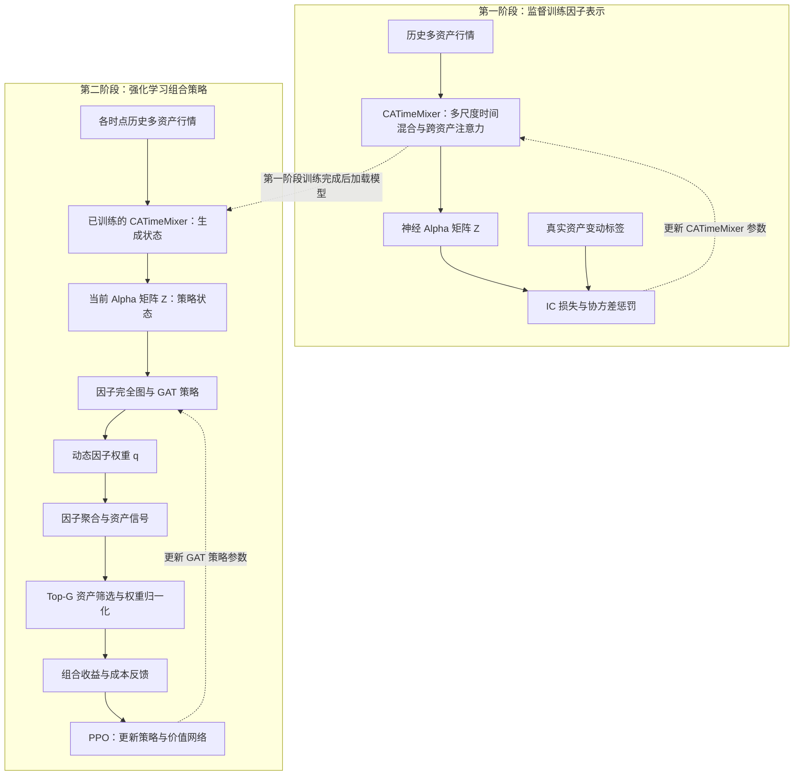

# AlphaGAT 论文解读

> - 速读卡：[AlphaGAT](../cards/2025_AlphaGAT.md)
> - 文献版本：[IJCAI 2025 正式论文](https://www.ijcai.org/proceedings/2025/0834.pdf)，pp. 7500–7508

## 核心结论

AlphaGAT 将神经因子生成与投资组合优化划分为两个阶段。CATimeMixer 从多资产、多尺度历史行情中提取具有预测能力且低冗余的神经 Alpha；GAT 将 Alpha 作为图节点建模因子关系，再以 PPO 根据组合收益学习动态因子权重。论文的关键区分是资产关系与因子关系分别建模，以及因子预测目标与组合收益目标分别优化。实验支持完整框架及两阶段主要架构的作用，但未独立分离协方差损失的贡献。

## 1. 研究背景与问题

组合选择需要从低信噪比的市场数据中提取有效信息，并随数据分布变化调整资产配置。直接将原始行情输入策略网络，会使表示学习与交易决策同时承受噪声影响；仅以预测准确性训练信号，则未必能保证信号在交易组合中的价值（原文 Introduction）。

论文由此关注三个问题：如何结合不同时间尺度与资产间信息生成 Alpha，如何减少同时生成的 Alpha 之间的冗余，以及如何依据组合表现动态调整因子权重。这里的 Alpha 是神经网络输出的截面信号，不是可读的公式表达式。

## 2. 核心思路：神经因子表示与组合策略分阶段优化

第一阶段以截面预测能力和多样性为监督目标，将历史行情转换为一组 Alpha。多尺度时间建模用于提取不同频率的变化，跨资产注意力用于交换资产间信息；协方差惩罚限制因子冗余（原文第 4.2 节）。

第二阶段将第一阶段生成的 Alpha 作为策略状态，通过因子图注意力形成权重，再按交易后的组合收益训练策略。该设计使策略依据当前因子暴露与因子关系调整组合，而不要求每个因子的预测能力始终稳定（原文第 4.3 节）。

两阶段的注意力具有不同对象：第一阶段沿资产维度建模，第二阶段沿因子维度建模。因子权重与最终资产权重也属于不同层次，不能直接等同。

## 3. 方法设计

### 3.1 总体框架与数据对象

设历史窗口长度为 k、资产数为 m、原始字段数为 d、Alpha 数量为 n。时点 t 的输入截止于 t-1：

```text
X_t 的形状为 k × m × d
Z_t = M(X_t)，形状为 n × m
```

M 为 CATimeMixer，Z_t 的每行表示一个 Alpha 在全部资产上的暴露。第二阶段输出 n 维因子权重 q_t，经因子聚合得到 m 维资产信号 v_t，最后转换为资产组合权重 w_t。



实线表示数据与评价信号的传递，虚线标明参数更新或训练完成后的模型加载。第一阶段通过 IC 损失与协方差惩罚训练 CATimeMixer；第二阶段加载该模型，随行情变化生成 Alpha 状态，再通过 PPO 更新组合策略与价值网络（原文第 4.2–4.3 节、Algorithm 1 第 3、10、14 行）。Algorithm 1 未列出对 CATimeMixer 的更新，也未描述组合收益目标向第一阶段联合反向传播。因此两阶段衔接的是因子表示，分别优化预测与多样性目标、组合收益目标；第二阶段的 Alpha 数值随输入行情变化，不表示因子生成模型继续参与训练。

### 3.2 CATimeMixer：多尺度时间特征与跨资产关系

CATimeMixer 通过平均池化形成多个时间尺度，并将各尺度分解为趋势项与季节项。趋势信息由粗尺度向细尺度传递，季节信息由细尺度向粗尺度传递；Conv1D 用于混合跨尺度表示（原文第 4.2 节、Figure 2）。

时间混合后，多头注意力沿资产维度传播信息。该过程并非仅在输出端执行一次：论文堆叠三个相同层，各层输出进入下一层，交替建模时间结构与资产关系。不同尺度的最终表示经输出映射后求和，得到 Z_t。

这一设计针对的是原始行情中的多尺度变化与资产联动。它扩展了神经因子的表达能力，但没有将神经输出还原为符号公式。

### 3.3 预测能力与协方差约束

第一阶段以因子与真实资产变动的平均截面 IC 为预测目标。以下以 r,s 表示因子、a 表示资产，避免原文索引复用：

```text
L_IC = -(1/(n*T)) * sum_{t=1..T} sum_{r=1..n} Corr_a(z^r_{t,a}, y_{t,a})  （式 3）
```

```text
L_cov = (1/(n^2*T)) * sum_{t=1..T} sum_{r=1..n} sum_{s≠r} |C_{rs,t}|  （式 4）
L = L_IC + λ * L_cov  （式 5）
```

T 为训练时间样本数，C_{rs,t} 为因子间协方差。预测目标使用有符号 IC，多样性项惩罚正、负协方差的绝对值。论文文字称其降低相关性，但公式实际约束协方差，具有尺度敏感性；它不等同于标准化后的相关系数约束。

两项损失分别针对信号预测能力与因子冗余，不能将总损失的效果直接归因于其中任意一项。

### 3.4 因子图注意力与资产配置

第二阶段以 n 个 Alpha 构造完全图，每个节点特征是该 Alpha 的 m 维资产暴露。GAT 对节点进行注意力聚合，经线性映射与 softmax 得到因子权重（原文式 7–10）：

```text
q_t^i > 0，sum_i q_t^i = 1
```

依据论文给出的张量维度，因子权重与 Alpha 矩阵沿因子维聚合为：

```text
v_{t,a} = sum_{r=1..n} q_t^r * Z^r_{t,a}
```

该式是对原文 v_t=q_t*Z_t 的维度解释。令 G_t 为信号最高的 G 个资产，最终资产权重为：

```text
w_{t,a} = exp(v_{t,a}) / sum_{j∈G_t} exp(v_{t,j})，当 a∈G_t
w_{t,a} = 0，当 a∉G_t  （式 6）
```

因此，因子权重非负归一化，最终资产组合也为非负、满仓的 Top-G 配置。因子信号本身仍可正可负，不能由 q_t≥0 推出所有资产信号均为正。

策略通过 PPO 接收组合收益与成本反馈。若 p_t 为收盘价相对向量、c_t 为交易成本比例，论文奖励为 `r_t = (w_t^T * p_t) * (1-c_t) - 1`。自适应性来自历史行情、Alpha 暴露、图注意力与组合权重的逐期变化，论文没有另设市场状态分类器。

## 4. 实验证据

### 4.1 实验设置与比较范围

| 数据集 | 资产数 | 训练期 | 验证期 | 测试期 |
| --- | ---: | --- | --- | --- |
| DJIA | 29 | 2010-01–2020-09 | 2020-09–2022-01 | 2022-01–2023-06 |
| HSI | 56 | 同上 | 同上 | 同上 |
| CSI | 98 | 同上 | 同上 | 同上 |
| CRYPTO | 18 | 2018-01–2023-01 | 2023-01–2023-09 | 2023-09–2024-04 |

原文 Table 2 给出上述固定切分。输入为八个量价字段、30 期历史，生成 64 个 Alpha；协方差系数为 0.1，交易费率为 0.25%，强化学习实验使用五个随机种子。主要交易指标为累计财富、年化收益、Sharpe 与 Calmar 比率。

### 4.2 神经因子架构的作用

Table 4 分别比较 TimeMixer、加入 Conv1D 的 CTimeMixer、加入资产注意力的 ATimeMixer 及完整 CATimeMixer。完整模型的结果为：

| 数据集 | IC | RankIC |
| --- | ---: | ---: |
| DJIA | 0.026 | 0.027 |
| HSI | 0.022 | 0.023 |
| CSI | 0.014 | 0.016 |
| CRYPTO | 0.039 | 0.038 |

四个数据集的 IC 与 RankIC 均高于基础 TimeMixer，支持多尺度 Conv1D 与跨资产注意力组合的有效性。该表未单独移除协方差损失，因此不能据此量化多样性正则项的独立贡献。

### 4.3 因子关系建模与动态权重的作用

Table 3 固定第一阶段，比较 GAT + RL、MLP + RL、随机权重、top-IC 规则与等权组合。累计财富如下：

| 方法 | DJIA | HSI | CSI | CRYPTO |
| --- | ---: | ---: | ---: | ---: |
| GAT + RL | 1.428 | 1.359 | 1.239 | 3.288 |
| MLP + RL | 1.357 | 1.277 | 1.139 | 2.691 |
| 随机权重 | 1.182 | 1.132 | 1.085 | 1.909 |
| top-IC | 1.228 | 1.167 | 1.114 | 1.766 |
| 等权 | 1.241 | 1.173 | 1.104 | 1.639 |

完整模型的累计财富均较高。同样采用 RL 时，GAT 相对 MLP 的比较支持因子关系建模的增量作用；与简单权重规则的比较支持动态策略的作用。结论不适用于所有风险指标：DJIA 的 MLP Calmar 为 1.732，高于完整模型的 1.507；总体 Table 1 中，CRYPTO 的 FinRL-Meta Calmar 也高于 AlphaGAT。

## 5. 研究结论

AlphaGAT 的贡献是将多尺度、跨资产神经因子表示与基于因子关系的组合策略衔接。两阶段分别通过预测与多样性目标、交易收益目标优化，使因子表示和实际配置具有明确分工。架构及组合消融支持主要设计在所报数据上的作用，不能进一步视为全部组件均已获得独立验证。

### 局限与未披露

- 正文未明确第一阶段收益标签的计算公式与预测期限；只有固定时间切分，部分资产因缺失数据被剔除，名单与成分变化处理未完整说明。这些因素限制跨研究比较与泛化判断。
- 协方差损失具有尺度敏感性：缩小因子幅度不改变 IC，却会降低该项惩罚。论文未讨论相应的尺度约束，相关效果也缺少独立消融。
- GAT softmax 的确定性权重与 Algorithm 1 中随机策略动作的关系未展开，Top-G 的具体 G 及成本比例与换手的映射也未明确；因此本文只能解释论文给出的组合机制，不补全其训练与交易协议。

### 针对的问题

| 问题 | 定位 | 对应机制 |
| --- | --- | --- |
| P2 表达能力与可解释性的权衡 | 主要 | 第 3.2 节：直接学习神经 Alpha 表示 |
| P8 挖掘目标与实际使用脱节 | 主要 | 第 3.4 节：以交易收益训练动态因子组合策略 |
| P7 因子同质化与冗余 | 涉及 | 第 3.3 节：协方差多样性约束 |
