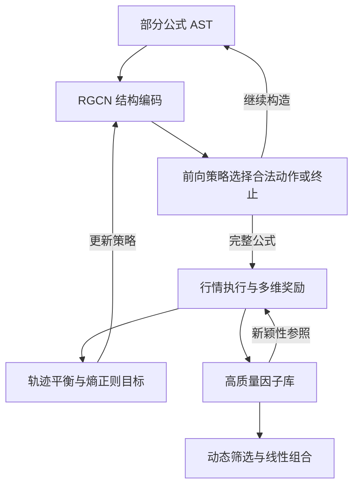

# AlphaSAGE 论文解读

> - 速读卡：[AlphaSAGE](../cards/2025_AlphaSAGE.md)
> - 文献版本：[arXiv v3](https://arxiv.org/html/2509.25055v3)，正文及附录 A–F

## 核心结论

AlphaSAGE 将公式因子挖掘建模为结构感知的分布学习：用 RGCN 编码部分公式的抽象语法树，以 GFlowNet 学习按奖励成比例采样完整公式的生成策略，并结合预测能力、结构—行为一致性与新颖性奖励。其目标是生成多个高质量模式，而非仅提高单个最优候选的分数。实验表明，主要增益依赖结构编码与复合奖励的配合，不能单独归因于将 RL 替换为 GFlowNet。

## 1. 研究背景与问题

公式挖掘需要在庞大的离散表达空间中持续产生有效且互补的信号。论文讨论的池奖励 RL 将新公式加入现有池后的组合 IC 增量作为回报，但池状态变化会改变奖励条件，单纯集中于高回报路径还可能造成模式集中（原文第 1–2 节）。

另一困难在于表示。逆波兰记法便于序列生成，但 token 邻接不直接反映运算依赖、左右操作数或时间窗口的角色。若策略不能识别这些结构，部分公式状态的表达能力与相似性判断都会受到影响。

因此，论文同时关注公式生成的学习信号与结构表示，以及高质量候选之间的多样性。

## 2. 核心思路：结构感知的奖励比例采样

GFlowNet 将完整公式视为终端对象，学习与其奖励成比例的采样分布。与集中优化一个最大值相比，这一目标为覆盖多个高奖励模式提供了建模方式，但其分布性质以奖励定义和训练目标得到满足为条件（原文第 2.4、3.2 节）。

AlphaSAGE 为该生成过程配置 AST 结构编码器，并使结构嵌入与真实因子行为建立联系。预测奖励决定候选质量，结构—行为奖励约束表示的一致性，新颖性奖励抑制与已发现因子的重复。生成完成后，因子再通过动态筛选与线性组合形成 Mega-Alpha（原文第 3 节）。

## 3. 方法设计

### 3.1 总体框架与学习对象

| 对象 | 含义 | 作用 |
| --- | --- | --- |
| 部分 AST s_t | 尚未完成的表达式树 | 生成策略的状态 |
| 终端公式 α | 完整合法的表达式 | 在行情上执行并计算奖励 |
| 已知因子库 F_known | 已发现的高质量因子 | 新颖性评价的参照 |
| 因子组合 | 从候选库中筛选并线性聚合的信号 | 下游预测与组合评价 |



网络以公式状态为条件，行情主要用于终端评价。不能将 RGCN 解释为直接从股票关系图预测收益的模型。

### 3.2 AST 关系编码与终止机制

公式从空状态逐步构造，动作添加算子、特征或其他 token，非法动作由状态相关掩码屏蔽。RGCN 为 AST 中不同计算关系使用不同参数：一元操作、可交换二元操作、非交换二元操作的左右输入，以及滚动算子的特征输入与时间输入共形成六类关系（原文第 3.3 节、附录 C.2）。

例如，减法的左右操作数具有不同角色，滚动均值中的字段与窗口也不是同类节点。关系编码保留这些差异，经节点聚合与最大池化得到公式嵌入 e_α（原文式 7–8）。

原文式 (4) 另设合法状态的提前终止概率 p_es(s_t)=Len(s_t)/MaxLen，用于抑制过长表达式。它控制生成长度，不直接评价经济有效性。

### 3.3 多维奖励的分工

总奖励为：

```text
R(α, T) = R_IC(α) + λ(T) * R_SA(α) + η(T) * R_NOV(α)  （式 14）
```

T 表示训练进度。三项分别承担以下作用：

- R_IC：先计算每日截面 Pearson 相关系数，跨日平均后取绝对值，即 `R_IC(α) = abs(mean_d Corr(α(X_d), y_d))`（式 12）；不同于先逐日取绝对值再平均。
- R_SA：在嵌入空间选择近邻，并以其历史输出的行为距离评价结构表示的一致性（式 9–11）。
- R_NOV：以候选与已有因子的最大绝对相关度抑制冗余：

```text
R_NOV(α) = 1 - max_{α'∈F_known} |IC(α, α')|  （式 13）
```

结构—行为奖励可写为 `exp(-sum_j w_ij * d_behav(α_i, α_j))`，其中 w_ij 由嵌入距离归一化得到。它鼓励结构近邻在行为上具有一致性，并不直接鼓励所有公式互相接近；抑制库内冗余由新颖性项承担。

辅助奖励权重随训练进度衰减，使前期结构学习与探索逐步转向预测表现。原文权重调度符号存在 T/t 混用，不能据此补造额外调度规则。

<a id="trajectory-balance"></a>

### 3.4 轨迹平衡与探索目标

对完整轨迹 τ=(s_0,...,s_n=α)，GFlowNet 的目标为：

```text
P_θ(α) = R(α) / Z
Z = sum_{α'∈X} R(α')  （式 5）
```

轨迹平衡约束从起点到终点的前向概率、反向概率和终端奖励：

```text
L_TB(τ) = [log Z_θ + sum_{t=1..n} log P_F(s_t | s_{t-1})
           - log R(s_n) - sum_{t=1..n} log P_B(s_{t-1} | s_t)]^2  （式 6）
```

P_F 与 P_B 分别为前向、反向策略，Z_θ 为学习的总流量。完整公式获得奖励后，整条轨迹参与更新；训练目标另加入动作熵正则，缓解过早集中（式 15–16）。

奖励比例采样解释了方法的分布目标，但不意味着任意训练结果都已满足该分布。尤其新颖性参照库更新时，奖励也会改变，不能将全文含池依赖项的训练过程概括为完全静态的目标。

### 3.5 下游动态组合及理论作用

第 3.5 节沿用动态筛选与线性回归的组合思路，按近期有效性从候选库选择因子，再更新 Mega-Alpha。附录 B.1 讨论一般正则化组合形式，但不能将该一般目标直接视为实验组合器的完整配置。

附录 F 从线性组合估计方差说明多样性的价值。若标准化因子矩阵的协方差为 Σ，OLS 系数方差与 Σ^{-1} 成正比；高度相关导致小特征值，从而放大估计不稳定性。这是低冗余有助于组合稳定性的条件性分析，不是对 GFlowNet 采样正确性或全部交易结果的证明。

## 4. 实验证据

### 4.1 数据与评价口径

中国市场包含 CSI300、CSI500、CSI1000：训练 2010–2020，验证 2021，测试 2022–2024。S&P500 使用训练 2010–2016、验证 2017、测试 2018–2020，数据源限制使美国样本截至 2020 年末（原文第 4.1 节）。

预测指标包括 IC、ICIR、RankIC、RankICIR；组合指标包括年化收益、回撤和 Sharpe。附录 D.1 对 CSI300/CSI500 使用前 20% 股票、20 日持有期的多头规则，对 S&P500 使用前后各 10% 的多空规则；CSI1000 的组合细节未单独展开。这些差异限制跨市场收益的直接比较。

### 4.2 完整框架与组件增益

Table 1 中，CSI300 的 AlphaSAGE 报告 IC 0.079、RankIC 0.094、年化收益 7.62%、Sharpe 1.71。整体表现优于多数对照，但 CSI1000 的 RankIC 与 RankICIR 并非无例外领先，不能将正文总体描述扩大为所有指标第一。

CSI300 的逐步组件实验提供了更直接的设计证据（Table 2）：

| 配置 | IC | RankIC | 年化收益 | Sharpe |
| --- | ---: | ---: | ---: | ---: |
| 基础 GFlowNet | 0.048 | 0.057 | 3.63% | 0.72 |
| 加提前终止 | 0.046 | 0.060 | −0.47% | −0.11 |
| 再加结构编码 | 0.070 | 0.088 | 5.58% | 1.25 |
| 再加结构—行为奖励 | 0.071 | 0.088 | 4.68% | 1.14 |
| 再加新颖性奖励 | 0.075 | 0.092 | 6.77% | 1.53 |
| 再加熵正则 | 0.079 | 0.094 | 7.62% | 1.71 |

结构编码对应较大的预测改善，但逐步加入组件并非完整的全因子实验，增益具有条件依赖性。例如结构—行为项并未使所有指标同步提高。Table 10 进一步显示，没有配套结构组件时 GFlowNet 弱于 RL，支持贡献来自生成目标、结构编码与奖励设计的组合。

附录 E 还比较编码器、长度、池容量与训练开销。RGCN 在对应预算下优于序列编码参照；训练时间比较与搜索进展属于不同效率维度，不能用预测表现直接代替计算成本结论。

## 5. 研究结论

AlphaSAGE 的主要推进是把公式结构表示与奖励比例采样结合，以多维奖励同时评价质量、结构一致性和新颖性。实验支持结构编码及复合目标的重要性，而非单独证明某一生成范式在所有设置下更优。

### 局限与未披露

- 式 12 的预测奖励取平均 IC 的绝对值，为非负量；这不能单独保证所有候选的总奖励严格为正。轨迹平衡使用 log R，零奖励与退化截面的处理未完整说明。结构—行为距离的资产维归约、反向策略与准入规则也存在披露缺口。
- 提前终止公式与 Algorithm 1 中随机数比较方向存在差异，二者对应的停止概率不能同时直接成立；此处不以外部实现补全。
- 每个市场使用一个固定切分，交易费率与动态组合的完整选择协议未充分展开。多样性理论依赖线性估计条件，不足以单独确立长期样本外或交易收益保证。

### 针对的问题

| 问题 | 定位 | 对应机制 |
| --- | --- | --- |
| P4 学习信号稀疏、延迟且不可微 | 主要 | 第 3.3–3.4 节：多维终端奖励与轨迹平衡学习 |
| P7 因子同质化与冗余 | 主要 | 第 3.3 节：新颖性奖励与多模式采样目标 |
