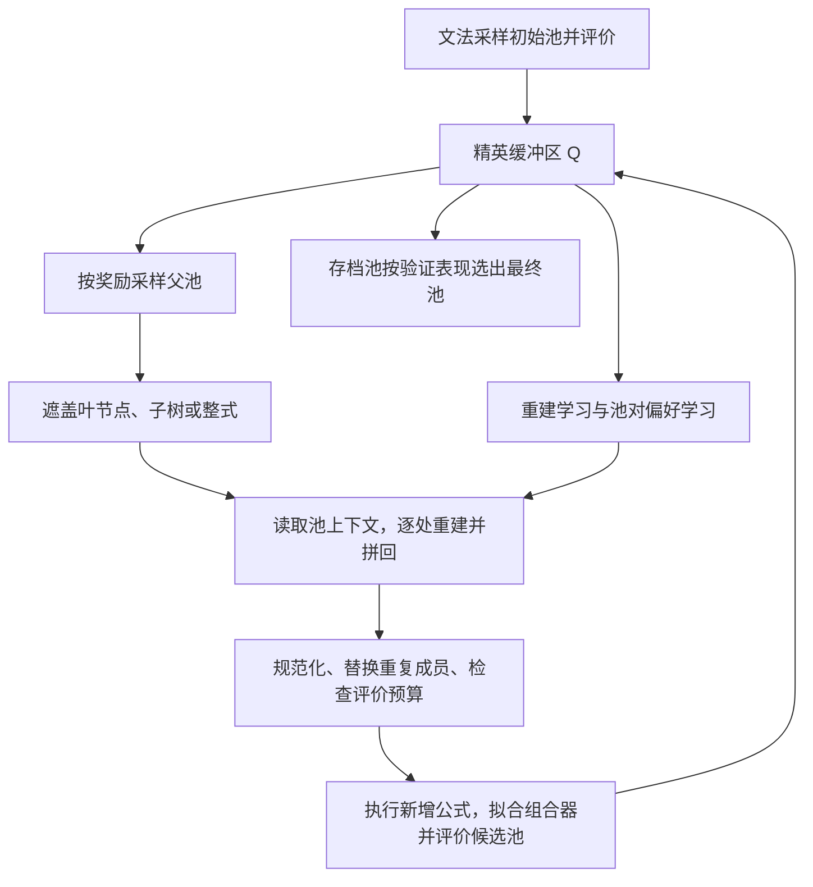

# AlphaPADI 论文解读

> - 速读卡：[AlphaPADI](../cards/2026_AlphaPADI.md)
> - 文献版本：[arXiv v2](https://arxiv.org/html/2610.04959v2)，2026-10-08；正文及附录 A–C。

## 核心结论

AlphaPADI 将完整因子池作为公式挖掘的生成、评价与学习单位。模型读取池内其他公式的上下文，通过层次化离散扩散改写叶节点、子树或整条公式；池级奖励同时衡量联合预测能力与成员冗余，再通过精英缓冲区和池对偏好学习反馈给生成器。论文在统一静态 ridge 组合器下比较各方法，结果支持池上下文、冗余约束与偏好学习的联合设计；其评价次数预算不等同于统一计算预算，理论分析也不保证有限训练达到最优池分布。

## 1. 研究背景与问题

公式因子通常以历史量价数据为输入，输出股票截面的预测分数。实际使用时，多个因子经组合形成最终信号，单条公式的预测能力并不足以决定组合质量：若新因子与已有因子高度相关，较高的单因子 IC 也可能没有明显增量。

论文将已有做法概括为两类。第一类逐条提出公式，以加入已有池后的边际收益为奖励；第二类先构建候选库，再筛选或动态组合。两者可以在评价阶段考虑互补性，但生成对象仍主要是单条公式。作者据此提出：当评价目标是完整池的联合表现时，生成模型也应读取池的当前构成，并能够同时改变其中的成员（原文第 1、3 节）。

这一目标还面临学习信号的困难。池奖励需要执行公式、拟合组合器并计算预测指标，无法直接对公式生成过程求导；若每次更新都重新生成并评价完整池，又会增加历史面板求值成本。

## 2. 核心思路：池条件生成与奖励排序

作者将搜索对象写为大小为 $K$ 的公式集合 $F$，学习池条件分布 $P_\theta(F'\mid F)$。池的作用由奖励计算延伸到生成状态：改写某个成员时，模型能够利用其余成员及已经完成的修改，而不是独立生成 $K$ 条公式后再检查相关性（原文式 2、第 4.2 节）。

层次化扩散为这种改写提供不同尺度的操作。遮盖叶节点对应局部特征替换，遮盖内部子树对应结构修改，遮盖根节点对应整式重建；反向模型在同一池上下文下逐步补全。池级奖励随后转为高、低奖励池之间的偏好关系，避免要求奖励函数可微。已评价池保存在缓冲区中，供多次训练复用（原文第 4.2–4.3 节）。

这里的设计依据是生成与评价单位的一致性，不能仅凭这一结构判断它必然优于逐因子搜索，相关证据需要来自统一组合与预算口径下的实验。

## 3. 方法设计

### 3.1 总体框架与池的生命周期

因子用逆波兰记法（RPN）表示，并解析为抽象语法树（AST）。词表包含量价特征、常数、窗口和算子；初始化按文法合法的 token 均匀采样，不依赖外部因子库（原文第 4.1 节、附录 A.1）。

图中区分了候选评价与模型更新。前者可能消耗新的公式评价预算；后者复用已评分池。缓冲区仅保留高奖励池，存档则用于最终验证选择；最终池的 ridge 组合权重在训练期拟合，验证与测试期间冻结（原文 Algorithm 1、第 4.4 节）。

### 3.2 结构化遮盖与逐处重建

每个可吸收节点 $u$ 具有独立时钟 $U_u\sim\mathrm{Uniform}(0,1)$，同一时钟在各扩散层共享。前向过程以阈值 $\rho_t$ 遮盖满足条件的最高子树：若祖先已经被遮盖，其后代不再作为独立遮盖位置。窗口参数不属于可吸收节点。腐化池定义为：

$$
F_t=\Phi_{\rho_t}(F_0),\qquad
\rho_t=1-\cos\!\left(\frac{\pi t}{2T}\right),\qquad t=0,\ldots,T.
\tag{6}
$$

$t=0$ 对应完整池，$t=T$ 时每条公式退化为根遮罩。生成时从已有池的部分腐化状态出发，而不是每次从全遮罩开始。论文使用 $T=32$、起始比例 $\alpha=0.5$，对应层 $t_0=16$；由式 (6) 得到 $\rho_{16}\approx0.293$，层数比例与节点遮盖比例是不同概念。

例如，以下是结构改写的示意，非论文实验实例。对公式 $\mathrm{TsMean}(\mathrm{Close},5)-\mathrm{Open}$，遮盖 `Close` 得到 $\mathrm{TsMean}(m,5)-\mathrm{Open}$；遮盖左子树得到 $m-\mathrm{Open}$；遮盖根节点则得到 $m$。三种情况分别保留不同程度的原公式结构。

反向过程从 $t$ 到 $t-1$ 时，以 $(\rho_t-\rho_{t-1})/\rho_t$ 选择本步需要恢复的遮罩。共享 Transformer 编码各公式，集合注意力汇总池上下文；自回归解码器在文法约束下生成目标子树。每恢复一处就立即拼回当前池，后续恢复重新读取更新后的上下文。因此，池内成员的生成具有条件依赖，并非若干独立解码的拼接（原文第 4.2 节、式 7）。

候选池完成后进行规范化，重复成员被随机合法公式替换，使池内保留 $K$ 条互异公式。结构互异仍可能产生高度相关的数值信号，因而还需要行为层面的冗余奖励。

### 3.3 联合预测奖励与最近邻冗余

对池 $F$，先在训练期拟合 ridge 组合器，再以组合预测与未来收益的平均日度 Spearman 相关定义 $R_{\mathrm{outer}}$。该奖励评价完整池联合使用的结果，不是各单因子 IC 的平均（原文式 3）。

对池内因子 $i,j$，令 $c_{ij}$ 为逐日绝对截面秩相关的时间均值，$d_i=\max_{j\ne i}c_{ij}$ 为因子 $i$ 与最相似邻居的相关性。冗余项为：

$$
R_{\mathrm{inner}}(F)=-\frac1K\sum_{i=1}^{K}[d_i-\delta]_+^2,
\tag{8}
$$

$$
R(F)=R_{\mathrm{outer}}(F)+w_{\mathrm{inner}}R_{\mathrm{inner}}(F).
\tag{9}
$$

其中 $[x]_+=\max(x,0)$，$\delta$ 是容忍阈值。该项惩罚每个成员最严重的冗余关系；低于阈值时不施加奖励或惩罚，不要求所有因子两两尽可能不相关。$R_{\mathrm{outer}}$ 保留预测目标，$R_{\mathrm{inner}}$ 限制组合拟合未必充分排除的成员重复。

### 3.4 缓冲区重建与池对偏好学习

缓冲区按标准化奖励的 softmax 分布采样池（原文式 10）。在这些池上，模型学习恢复被遮盖的子树，损失 $\ell_\theta$ 是按目标数与 token 数归一化的负对数重建分数。高奖励池更频繁进入重建训练，但这种加权学习并不直接比较两个池。

偏好项补充相对比较。对高奖励池 $F^w$ 与低奖励池 $F^l$，仅在奖励差超过缓冲区奖励标准差的指定倍数时接受该池对；两池使用相同的扩散层与腐化随机变量，降低分数比较中的随机差异。以初始化训练后的冻结模型 $\theta_{\mathrm{ref}}$ 为参照：

$$
\mathcal L_{\mathrm{pref}}=-\mathbb E\log\sigma\!\left(
\beta[\ell_\theta^l-\ell_\theta^w-\ell_{\theta_{\mathrm{ref}}}^l+\ell_{\theta_{\mathrm{ref}}}^w]
\right),
\tag{12}
$$

$$
\mathcal L_{\mathrm{AlphaPADI}}=
\mathcal L_{\mathrm{pref}}+\lambda_{\mathrm{VB}}\widehat{\mathcal L}_{\mathrm{VB}}.
\tag{13}
$$

$\sigma$ 是 sigmoid，$\beta$ 控制偏好强度，$\widehat{\mathcal L}_{\mathrm{VB}}$ 是独立采样批次上的重建目标。若没有合格偏好对，本次只做重建更新。奖励通过池的采样、排序与配对进入学习，梯度经过重建模型，不经过公式执行、ridge 拟合与真实相关性计算（原文第 4.3 节）。

附录 B 将其联系到 KL 正则化的奖励最大化，但实际使用的是归一化重建替代分数与确定性排序。理论结论有分布可达性等条件，不等于该训练目标是精确证据下界，也不保证有限步模型达到所述目标分布。

### 3.5 公式评价预算与最终组合

预算 $B$ 按首次提交的不同规范公式计数，初始化、随机替换和求值失败均计入；缓存命中不重复计数。若候选池所需的新公式会突破预算，该池被丢弃（原文式 4、Algorithm 1）。不同池可以复用既有成员，因此池评价次数不能简单写成 $B/K$。

所有返回池统一使用训练期拟合、随后冻结的静态 ridge 组合器。AlphaForge、AlphaSAGE 等基线的原生动态组合不在这一比较中启用。该设计比较的是共同下游映射下的池质量，论文中的基线结果因而不能直接与各自原文的完整系统结果对照。

## 4. 实验证据

### 4.1 数据、预算与交易口径

实验采用 CSI300、CSI500、S&P500 日频数据，按时点成分构建股票池，预测 20 个交易日远期收益。三个市场共用训练 2016–2020、验证 2021–2022、测试 2023–2025 的切分，并删除标签跨越切分边界的样本（原文第 5.1 节、附录 C.1）。

GP、AlphaGen、AlphaQCM、AlphaForge、AlphaSAGE 与 AlphaPADI 共用 40,000 次公式评价预算；AlphaAgent 未纳入该共享预算。池大小从 $K\in\{20,50\}$ 中按验证表现选择，结果报告五次运行均值。预算约束历史求值次数，未统一生成、训练或墙钟成本。

回测每日选预测前 20% 的股票等权组成子组合，各使用 $1/20$ 资金并持有 20 个交易日，买入成本为 0.0005、卖出为 0.0015。附录 IC、RIC 定义取平均相关的绝对值，不能据这两个报告值判断信号原始方向；奖励中的有符号相关与报告指标应分开理解。

### 4.2 统一组合下的整体效果

表 1 中 AlphaPADI 在三个市场的七项指标均列首位。以下选择秩相关与组合指标，分别反映预测排序和经共同交易规则映射后的结果：

| 市场 | RIC | RICIR | AR | SR | MDD |
| --- | ---: | ---: | ---: | ---: | ---: |
| CSI300 | 0.0659 | 0.4147 | 10.58% | 2.8619 | 14.12% |
| CSI500 | 0.0763 | 0.4578 | 14.35% | 3.5124 | 13.50% |
| S&P500 | 0.0452 | 0.4122 | 20.61% | 5.8423 | 8.60% |

这些结果支持所研究设置下完整方法的有效性。由于基线共用静态组合器，比较强调池的生成质量；它不覆盖各方法原生组合机制的优劣，也不构成同等总计算资源下的效率比较。

### 4.3 组件是否改善池质量

CSI300 的表 2 按论文顺序逐步增加组件：

| 配置 | IC | RIC | SR | MDD |
| --- | ---: | ---: | ---: | ---: |
| 基础扩散，不使用池上下文 | 0.0215 | 0.0334 | 1.9722 | 27.08% |
| 加池上下文与重建项 | 0.0276 | 0.0386 | 1.9039 | 22.49% |
| 加联合预测奖励 | 0.0354 | 0.0463 | 2.3414 | 23.33% |
| 加冗余奖励 | 0.0396 | 0.0531 | 2.6810 | 19.15% |
| 加偏好学习，完整方法 | 0.0439 | 0.0659 | 2.8619 | 14.12% |

预测相关性逐步改善，但风险收益指标并非每一步都同步改善。加入冗余奖励后回撤下降、SR 上升，ICIR 却从 0.2684 降至 0.2510；偏好项进一步提高 RIC 与 RICIR。该消融支持这些设计在累积配置下的作用，不能解释为各组件独立、可相加的增益。基础行的损失列与文字描述存在歧义，对池上下文本身的独立归因需要保留这一限制。

池容量实验显示 $K=50$ 并非始终优于 $K=20$，与“池质量取决于联合使用而非成员数量”的设计判断一致。附录 C.2.5 的搜索曲线度量训练集表现，横轴是评价次数的展示缩放，不是训练步数或墙钟时间，不能据曲线推导样本外泛化或运行速度。

## 5. 研究结论

AlphaPADI 的贡献是将池构成引入生成模型，并以同一池级目标连接候选改写、缓冲区筛选和模型学习。层次化结构改写提供局部与整体两种搜索尺度，偏好学习则利用已评价池的相对质量提供不可微奖励下的学习信号。实验支持这些机制的联合效果，同时表明更大的池与更多独立公式并不自动形成更强组合。

### 局限与未披露

1. **生成与评价范围**：候选在已有精英池周围改写，结果受初始化、文法与规范化关系影响。论文未充分定义规范等价关系及冗余容忍阈值 $\delta$，这会影响预算计数和冗余惩罚的解释。
2. **比较范围**：每个市场只有一个固定时间切分，主要消融与敏感性分析集中于 CSI300；共享预算未覆盖 AlphaAgent，也未计入不同模型的训练与生成成本。
3. **统计证据**：论文报告五次均值并声称相对最强基线达到 $p<0.05$，但未给完整离散度、逐项检验方法与结果，难以评估差异的稳定性。累积消融也不足以分离全部组件交互。
4. **理论与使用条件**：归一化重建是替代目标，偏好理论依赖理想化条件；实际训练与候选过滤不由有限步收敛保证覆盖。交易结果限于所用成本与组合规则，未评价市场冲击、容量等条件。

### 针对的问题

- **P4（主要）**：把不可微池奖励转成重建采样与池对偏好信号。
- **P7（主要）**：池上下文、最近邻冗余惩罚与重复成员替换共同约束同质化。
- **P8（主要）**：以完整池及其联合拟合结果连接生成、评价和最终选择。
- **P3（涉及）**：按不同公式计评价预算，复用缓冲区与公式求值结果。
