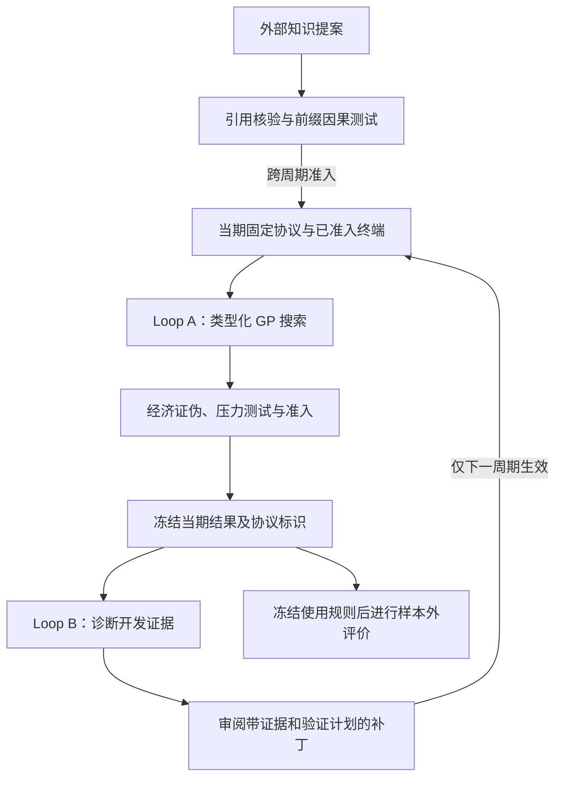

# EvoQuantLab 论文解读

> - 速读卡：[EvoQuantLab](../cards/2026_EvoQuantLab.md)
> - 文献版本：[arXiv v2](https://arxiv.org/html/2610.17130v2)，2026-10-14；正文及附录 A–G。

## 核心结论

EvoQuantLab 将量化研究划分为候选搜索与研究协议演化两层循环：内层在当期固定协议下用类型化遗传规划搜索因子，外层依据已完成周期的诊断证据调整下一周期的基元、预算或评价规则。LLM 用于知识提案与协议审阅，不训练模型参数。论文报告了三个任务中的样本外表现和组件消融，支持双循环设计的整体作用；等预算零假设搜索提供了选择多重性的诊断形式，但所披露材料不足以确认完整自适应研究过程的统计错误率已受控。

## 1. 研究背景与问题

自动因子挖掘可以不断提出候选，并依据开发回测保留表现较好的表达式。但反复选择的对象不限于公式：终端特征、算子、预算、筛选阈值与评价指标也可能随反馈改变。即使最终因子形式简单，它仍可能来自大量候选与协议选择，单次开发期高分不足以证明样本外有效性（原文第 1 节）。

LLM 研究智能体进一步扩大了可调整的环节。外部知识能扩充搜索空间，模型也能根据失败结果修改研究流程；如果候选生成、协议修改和最终评价使用同一反馈，研究者便难以区分方法改进与对开发历史的适应。

论文由此关注两个目标：在保留自适应研究能力的同时，使每次搜索的条件可以追溯；把诊断对象由最终因子扩展为产生该因子的搜索与选择过程。

## 2. 核心思路：周期内固定，周期间演化

作者将候选级搜索交给快速 GP 循环，将较慢的知识审查和协议修改置于外层。一个周期内固定任务、终端、算子、评价规则与预算；周期结束后先冻结结果，再允许外层提出下一周期补丁。已完成周期永久保留原协议标识，最终样本外数据不进入搜索反馈（原文第 3.1–3.4 节）。

这一设计区分了三种信息流：当期候选接受开发期评价；外部知识先作为待验证提案；协议诊断只能改变后续周期。其作用是明确每项决策依据何种证据，避免用后来修改的协议重新解释旧结果。周期之间仍存在适应性，因此版本化是统计分析的条件，不能单独替代对协议选择本身的校准。

## 3. 方法设计

### 3.1 整体框架与研究状态

数据划分为训练、开发和最终样本外三部分。周期 c 的协议记为：

```text
Π_c = (S_c, T_c, O_c, M_c, B_c)
```

其中 S_c 是任务与数据契约，T_c 是活跃终端集，O_c 是类型化算子，M_c 是评价规则，B_c 是搜索与试验预算。因子 g∈G(T_c,O_c) 为表达式树，对资产—时间观测输出标量分数（原文第 3.1 节）。



图表示论文两层循环的关系。样本外结果是最终评价，不是 GP 适应度或协议补丁的输入；逐周期 OOS 曲线是事后回顾，不能据曲线反推当期可见的奖励。

### 3.2 分层证据管线

论文用 L0–L6 描述候选从数据到组合的评价链（原文第 3.2 节）：

| 层级 | 对象与作用 |
| --- | --- |
| L0 Data | 统一面板与可交易股票池，建立 purged 开发折和前缀检查 |
| L1 Factory | 管理有经济含义的类型化终端；外部知识先进入隔离队列 |
| L2 Tree GP | 在当前合法空间内演化因子树 |
| L3 Falsify | 用仅保留/删除分支、符号翻转、参与者互换和残差化检验经济机制与增量 |
| L4 Stress Battery | 检查趋势与波动状态、执行延迟、资产簇及零假设搜索 |
| L5 Admit | 在接触 OOS 前冻结表达式、终端清单、数据版本与指标配置 |
| L6 Portfolio | 按任务定义将信号转成持仓，并评价组合结果 |

L0 的前缀重放不变性要求：对于 τ<τ'，由 D_{1:τ} 与 D_{1:τ'} 计算的特征在共享前缀上相同。该条件检验追加未来数据是否改写过去特征；真实字段的发布时间、成分历史和修订语义仍由数据契约承担。

L3 进一步区分预测能力与经济解释。删除某分支后表现不降，可能说明原表达式存在不必要复杂度；对登记载体做截面残差化后失效，则说明增量依赖这些已知暴露。结论取决于所选反事实和载体集合，不能据局部检验证明全部经济叙事。

### 3.3 内层 GP 与知识准入

GP 使用锦标赛选择、类型化子树交叉和点变异。开发适应度取各折最差表现，减去由树大小与深度定义的复杂度罚项：

```text
f_dev(g; Π_c) = min_{k=1..F} Metric_k(g) - λ * Complexity(g)  （式 1）
```

F 为开发折数，指标按任务定义为越大越好。最差折目标限制只优化某一折的行为，但候选仍反复使用开发集，不能因此排除自适应过拟合。

语法重复或两两有符号相关 ρ>0.95 的表达式，被来自代表不足家族的定向移民替换；精英按家族分层保留，避免种群被单一家族占据。搜索期的结构多样性与最终持仓的行为相关性分别处理，前者不能保证组合互补（原文第 3.3 节）。

LLM 将论文、公告与研报中的机制整理成 Reference Card，先进入提案队列。通过逐点引用核验和前缀因果测试后，终端才可能在下一周期激活；边际表现弱但交互作用稳定者可作为 `INTERACTION-ONLY` 保留。终端还可转为 ACTIVE、DORMANT、BANNED，休眠不删除历史试验记录（原文第 3.3 节、附录 F）。

附录 D.3 的终端提案案例说明准入不是模型声明的自动采纳：相同表达式在两个配对种子下相对时间平移对照的最差折提升为 0.206、0.243，中位数 0.225 低于门槛 0.25，因而未被启用。该案例证明具体提案可以被否决，不提供一般错误率估计。

### 3.4 外层诊断与协议补丁

周期结束后，Gate 1 汇总训练到开发的退化、跨折与跨种子稳定性、复杂度、集中度、选择多重性、安慰剂和指标敏感性，形成 Pass、Overfit-Model、Overfit-Selection、Suspect-Leakage、Metric-Fragile 或 Insufficient 等诊断（原文第 3.4 节、附录 B）。

Gate 2 根据诊断审阅对应层的补丁，生成：

```text
Π_{c+1} = Apply(Π_c, A_c)
h_{c+1} = Hash(Π_{c+1})  （式 3）
```

A_c 包含修改位置、内容、证据、预期作用、风险与验证计划。缺少证据或验证计划、触及不可变任务字段的补丁被拒绝。补丁通过后改变下一周期，旧周期仍绑定 h_c，不回写为新协议下的结果。其方法贡献在于把协议变更变成有明确生效边界的研究决策。

<a id="selection-calibration"></a>

### 3.5 等预算零假设搜索的检验对象

选择多重性诊断将真实搜索的最高开发分数，与相同预算下零假设伪搜索的最高分数比较：

```text
m_real(T) = max_{t=1..T} f_dev(g_t; Π_c)
p̂_sel(T) = (1 + sum_{b=1..B_0} I[m_b_null(T) ≥ m_real(T)]) / (B_0 + 1)  （式 2）
```

T 是搜索试验预算，B_0 是区块置换零假设下的伪搜索次数。比较对象是一次搜索的赢家，而非单独检验最终每个因子。由公式可知最小可报告值为 1/(B_0+1)，故 B_0 同时决定检验分辨率。

这一形式将搜索规模纳入诊断，但“同等预算”不自动等于“完整重放同一选择过程”。式 (2) 在给定 Π_c 下定义；要解释整个双循环，还需说明零假设如何覆盖知识扩充、后续协议与最终周期的选择。论文未给完整外循环的零假设分布，因而不能由该式直接推出候选级 FDR 或全过程 FWER 控制。

## 4. 实验证据

### 4.1 任务与最终使用链

| 设置 | 日频权益 | 小时 Crypto |
| --- | --- | --- |
| 市场与标签 | CSI500、S&P500，下一日截面收益 | 数字资产，下一小时截面收益 |
| 训练/开发合并区间 | 2025-03-31 至 2026-04-30 | 2025-04-01 至 2026-03-31 |
| OOS | CSI500：2026-05-06 至 08-17；S&P500：2026-05-01 至 08-14 | 2026-04-01 至 06-09 |
| 使用链 | 筛选后 9/20 个因子输入 LightGBM，再转为中性持仓 | rank 信号经逆波动缩放、72 小时平滑后形成单因子持仓，再等权平均 |
| 交易口径 | 分数去截面均值，绝对权重和为 1；毛收益，未扣执行费与滑点 | 1 小时延迟，每小时调仓；扣单边换手 5 bp，不含永续资金费 |

以上依据原文表 1–2、图 4、附录 C.2。权益中的 LightGBM 与 Crypto 的持仓平均属于不同使用链，组合 IR 不能与单因子 IR 混用。保留原生工作流的四个基线统一使用 Claude Opus 5、共享数据和评估套件；论文没有据此说明全部方法具有相同候选总预算。

### 4.2 整体表现与冻结单因子迁移

主结果评价完整使用链：

| 任务 | IC | 组合 IR | AR | 累计收益 | MDD |
| --- | ---: | ---: | ---: | ---: | ---: |
| CSI500，表 2 | 0.0281 | 1.613 | 18.34% | 5.31% | −4.78% |
| S&P500，表 2 | 0.0233 | 1.614 | 21.30% | 6.17% | −5.82% |
| Crypto，图 4 | 0.0089 | 3.709 | 37.91% | 7.17% | −3.23% |

Crypto 上 RD-Agent 的 IC 为 0.0444、组合 IR 为 −1.870，表明在该使用链下，预测相关性与交易结果的排序不同；它不能证明 IC 无效，也不能单独识别执行映射产生差异的原因。

为减少组合器的影响，表 3 与附录 E 另按开发期 IR 选出一个因子，冻结后评价 OOS IR：

| 方法 | Crypto | CSI500 | S&P500 | 三市场平均 |
| --- | ---: | ---: | ---: | ---: |
| EvoQuantLab | 4.055 | 1.041 | 2.466 | 2.521 |
| RD-Agent-Quant | −0.229 | 1.002 | −0.082 | 0.230 |
| AlphaAgent | −2.385 | 0.798 | −0.490 | −0.692 |
| QuantaAlpha | −4.999 | −0.079 | 0.819 | −1.420 |
| FactorMiner | 0.952 | 0.547 | 1.382 | 0.960 |

该结果支持所报任务中开发期选择的迁移表现。表 8 的池规模 M 是留存候选数，不是全部试验预算 T；正号存活率的分母为开发期 IR 为正的留存因子，不能用其补数估计假发现率。

### 4.3 双循环及多样性机制的贡献

表 4 在所述相同候选预算下比较组件，按预声明规则选择并冻结因子后评价：完整方法的 Crypto OOS IR 为 3.709，仅 Cycle 0 为 1.570，去 Loop B 为 0.752，固定初始终端与算子空间为 2.331，去多样性控制为 1.712；以均匀采样替代 GP 更新时，无候选通过 L5。

这些对照支持 GP、协议演化、知识空间扩展和多样性机制在该设置下的作用。但消融未单独移除或校准式 (2)，整体提升不能归因于置换诊断已经控制假阳性。附录 D 的拒绝案例提供了具体决策依据，逐周期轨迹则属于事后观察；作者也明确不将某次协议变化后的改善视为受控因果证据。

### 4.4 效率的不同度量

表 5 报告 EvoQuantLab 用时 22h08m、50 次 LLM 调用、520,780 输入和 256,000 输出 token，按论文固定价格表计 API 费用为 9.000；QuantaAlpha 为 2h04m、94 次调用、767,897/455,379 token、费用 15.224。两者的 L5 因子吞吐分别为 0.95 与 10.2 个/小时。

相对 QuantaAlpha，EvoQuantLab 减少了调用、token 与 API 费用，但墙钟更长；其他三个基线的 API 费用也更低。因此，论文证据支持特定资源维度上的取舍，不支持全面效率优势。上述费用是论文实验口径，不是当前报价，也不包含完整计算成本。

## 5. 研究结论

EvoQuantLab 将可演化研究流程与固定周期证据联系起来：候选在明确协议下搜索，知识先验证再启用，补丁只改变下一周期，进入 OOS 前冻结最终使用链。实验支持双循环在所报任务中的有效性。其主要启示是将协议选择本身纳入研究对象；版本、账本与隔离规则为后续审计和统计分析提供条件，实际错误率控制仍需要完整搜索过程的校准证据。

<a id="limitations"></a>

### 局限与未披露

1. **选择诊断的证据缺口**：正文及附录未给 B_0、置换对象与区块规则、实际 p 值、阈值及伪搜索轨迹，也未明确是否重放全部 GP 反馈和跨周期选择。这限制了对统计校准的判断。
2. **数据与时间覆盖**：日频训练/开发期约 13 个月，OOS 约 3.5 个月；表 1 未列训练与开发的精确分界、各折及 purge 长度。短期迁移不等于跨长期市场状态稳定。
3. **交易与比较边界**：权益未扣费用与滑点，Crypto 未计资金费；不同任务使用链和方法预算不完全一致，不能将结果归结为单一因子生成能力。
4. **机制与披露**：完整终端、算子、搜索配置和阈值未列齐；主文强调 GP 候选搜索，附录对 API 模型提案范围的概括未细分知识基元与完整因子。公开记录与冻结产物仍是发布承诺，无法仅凭协议声明验证 OOS 隔离；模型预训练信息与测试时段的关系也未讨论。

### 针对的问题

- **P5（主要）**：最差折目标、复杂度约束与等预算零假设搜索共同诊断过拟合。
- **P6（主要）**：前缀不变性、purged 折、OOS 隔离与准入冻结限制信息回流。
- **P3（主要）**：GP 承担候选搜索，LLM 集中用于知识与周期审阅，减少部分模型调用开销。
- **P1、P2、P7、P10（涉及）**：分别对应类型化空间、经济证伪、族与持仓多样性，以及协议版本与试验记录。
