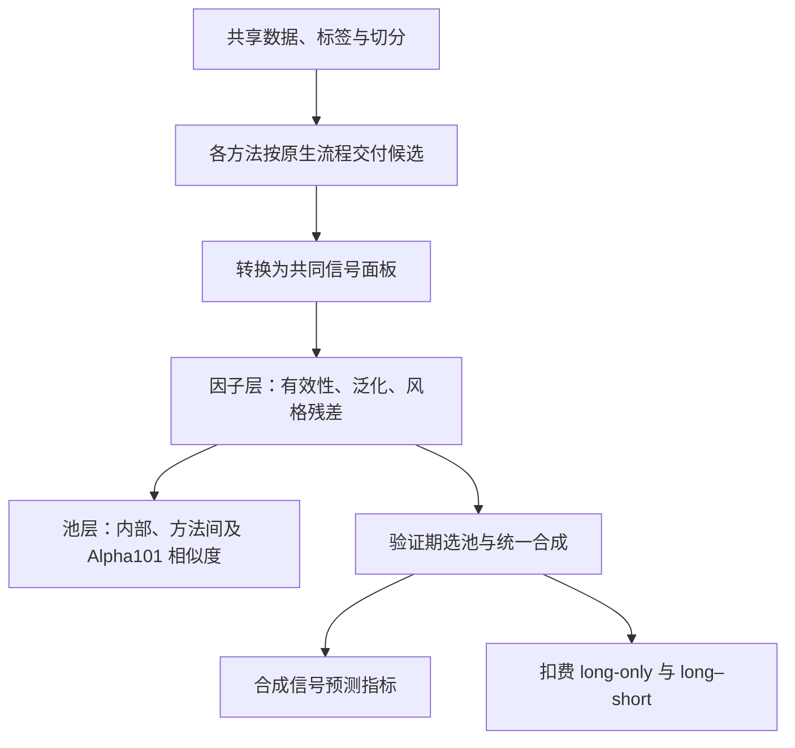

# FactorBench 论文解读

> - 速读卡：[FactorBench](../cards/2026_FactorBench.md)
> - 文献版本：[arXiv v1](https://arxiv.org/html/2610.06947v1)，2026-10-03；正文及附录 A–E。

## 核心结论

FactorBench 提出从单因子、因子池到扣费组合的分层评估，考察自动挖掘方法的改进能否转化为可泛化、具有差异且可用于组合的信号。基准在五个股票市场、共享数据与评价契约下比较九种方法，并以 Alpha101 为固定公式参照。结果显示，训练期预测优势、池规模和 long-only 收益都不足以单独代表挖掘进步；在所评估的具体实现与协议下，没有一种方法范式在所有层面占优。论文的贡献主要是可归因的比较框架，不是新的因子生成算法。

## 1. 研究背景与问题

公式搜索、强化学习、生成式方法与 LLM 智能体通常具有不同的数据、目标、搜索预算和下游组合方式。即使都报告 IC，也可能评价不同预测期限、不同因子筛选结果或不同使用链，跨论文数值难以说明生成机制本身是否进步（原文第 1–2 节）。

只评价单因子还会遗漏两类差异。首先，一个方法可能交付大量高相关公式，数量增加并未带来信息广度；其次，单因子预测能力需要经过选池、合成、调仓和费用才能转为组合结果。满仓多头还会包含共同市场收益，较高回报不一定来自独特的截面预测能力。

因此，论文关注的不只是因子是否有效，还包括池是否不同，以及这些信号在统一使用规则下是否保留经济价值。

## 2. 核心思路：沿使用链分层归因

FactorBench 将比较分成三个相互衔接的层次（原文第 3.3 节）：

| 评价层 | 核心问题 | 对应设计 |
| --- | --- | --- |
| 因子 | 能否执行、稳定评分并迁移到留出期 | 有效性筛选、固定方向、时间泛化与风格中性化 |
| 因子池 | 交付数量是否代表不同信号 | 方法内、方法间及相对 Alpha101 的信号相似度 |
| 组合 | 信号在共同使用规则下是否有扣费价值 | 验证期选池、统一合成、long-only/long–short 及敏感性分析 |

该设计保留中间评价对象：既报告合成信号的预测指标，也报告转为持仓后的结果。预测、冗余与交易映射的影响因而可以分别观察。三层结果共同约束结论，任何单层排名都不能直接代表一个方法范式的总体能力。

## 3. 基准设计

### 3.1 共同任务与方法接入

基准采用 Yahoo Finance 复权日频数据，覆盖 S&P100、HSI、CSI300、FTSE100、Nikkei225 五个固定成分池，共 782 只股票。HSI 为 85 只，CSI300 为固定的 272 只；样本期内不重建历史成分，因此存在幸存者偏差（原文附录 A）。

共同输入为 OHLCV、VWAP 代理、一日收益和滚动平均成交量。VWAP 代理定义为 (H+L+C)/3，不是真实成交额加权均价。目标为复权收盘价的 20 个交易日前向收益：

```text
y_{i,t} = C_{i,t+20} / C_{i,t} - 1  （式 1）
```

2016 年用于预热，训练期为 2017–2021，验证期为 2022–2023，测试期为 2024-01 至 2025-10。标签与表达式可访问的输入分开。各方法的符号表达式或程序输出都转换为日期×资产信号面板，然后进入共同评价链（原文第 3.2 节、附录 A–B）。

九种自动方法包括 GP、AlphaGen、AlphaQCM、AlphaCFG、AlphaForge、AlphaSAGE、R&D-Agent、AlphaAgent、QuantaAlpha；Alpha101 中 71 条适用公式作为非挖掘参照。各方法保留原生搜索目标、预算与输出方式，LLM 方法统一使用 Qwen3.8-27B。共享下游评价不等于等计算预算，也不意味着各方法完整原生系统均被保留：AlphaForge、AlphaSAGE 的原生组合阶段不进入这里的统一组合比较（原文附录 B）。



### 3.2 因子层：共同样本与方向固定

“可执行”表示候选成功产生信号；“可评分”还要求信号与目标在足够日期上有共同、有限且非恒定的截面。每个因子在训练、验证、测试各切分均须至少有 100 个可评分日，才进入共同可评分集合（原文第 3.3 节、附录 C.1）。

这一集合保证时间泛化比较使用同一批因子，避免缺失或退化信号进出样本造成聚合变化。它也意味着留出期覆盖情况参与了描述性分析样本的定义，应与“使用测试期预测分数选择因子”区分。论文声明测试结果不用于选池与调参，但共同可评分性仍是理解样本范围的必要条件。

方向由训练期 IC 的符号固定，验证与测试不重新翻转。负留出期 IC 因而保留了方向失效的信息。IC、RankIC 分别为日度截面 Pearson、Spearman 相关的均值；ICIR 为日度 IC 均值除以标准差，不年化，也不校正重叠标签的序列依赖，属于描述性指标（原文附录 C.2）。

时间退化先对同一因子计算训练与测试指标之差，再在方法—市场内取中位数：

```text
D_{m,k}(M) = median_{f∈F_{m,k}} (M_{f,train} - M_{f,test})
```

F_{m,k} 为方法 m 在市场 k 的共同可评分因子集。该配对定义不同于两期中位数之差。

### 3.3 风格中性化与独特性的含义

论文对每个因子做逐日截面回归：

```text
f_{i,t} = α_t + β_t^T * s_{i,t} + ε_{i,t}
```

s_{i,t} 包含五类历史可得暴露：252 日市场 beta、60 日波动率、剔除最近 21 日的长周期动量、21 日反转和 20 日流动性。以残差 ε 对原收益目标重新计算 IC，并用调整 R^2 描述风格重叠（原文附录 C.3）。

只有因子被中性化，收益目标保持不变；原始与残差 IC 使用匹配的日期—资产样本。这回答的是“因子剔除所测暴露后是否仍能预测原收益”，不能将残差称为纯 alpha，也不能把 IC 降幅或 R^2 解释为被消除的 alpha 比例。

### 3.4 池层：实现信号的相似度

对两个因子，先计算每日截面 Spearman 相关，再在切分内平均：

```text
C_{ij} = (1/|T_{ij}|) * sum_{t∈T_{ij}} corr(f_i(t,·), f_j(t,·))  （式 2）
```

报告值为 |C_ij|，不是逐日相关绝对值的均值。共同股票不足 20 只或截面恒定的日期不参与，恒定截面不记成零相关；切分覆盖不足一半的因子不进入相似度分析（原文附录 D）。

方法内先在单次运行中取因子对相似度中位数，再跨种子聚合；方法间以及相对 Alpha101 的比较则取两个池之间的因子对块中位数。它度量已实现信号的行为相似性，高相似不证明共同来源或复制，低相似也不保证预测信息与经济价值独立。

### 3.5 选池、合成与组合评价

每个方法—市场—种子池先固定训练期方向，再按验证期 IC 排序，贪心保留与所有已选成员验证期绝对 Spearman 相关低于 0.8 的候选；相关无法估计者被剔除。默认不限制入选数量，也不要求验证 IC 为正（原文附录 E）。该协议会使不同冗余结构的交付池形成不同大小的最终池。

合成比较等权、验证 IC 加权与 ridge，主结果使用 ridge：权重在训练期学习，正则强度按验证期选择，测试期固定。合成信号先评价预测指标，再按以下共同规则形成持仓：

| 设置 | long-only | long–short |
| --- | --- | --- |
| 选股 | 前 20%，等权 | 前 20% 做多、后 20% 做空 |
| 敞口 | 满仓 | 多头 +50%、空头 −50% |
| 调仓 | 每 20 个交易日 | 每 20 个交易日 |
| 成本 | 每交易 1 美元 10 bp | 同左，另计融券成本 |

论文未给出默认融券费率的具体数值。敏感性分析分别改变 0–50 bp 成本、1–20 日调仓间隔和合成方式，其余条件保持默认；这些实验用于分析使用规则的影响，不用于挑选测试期最优配置（原文第 4.3 节、附录 E）。

## 4. 实验证据

### 4.1 交付有效性与时间泛化

九种方法各在五个市场运行三次，共 135 次运行，交付 4,914 个因子实例；该数不是跨运行去重后的独特公式数。4,838 个可执行，占 98.5%；4,698 个可评分，占 95.6%。76 个执行失败来自 R&D-Agent 19 个、AlphaAgent 24 个、QuantaAlpha 33 个；Alpha101 的 71 条参照公式另计（原文表 1、附录 C.1）。

GP、RL 与生成式方法的训练期 IC 优势到验证期明显衰减，测试期未系统恢复。LLM 方法训练期 IC 较低、绝对退化较小，但留出期 IC 不因此系统性更高（原文图 2、8）。共同样本与固定方向使这一比较能够反映同一批信号的迁移，而不是只报告各时期的赢家。

中性化后多数方法 IC 下降，GP 降幅最大；GP 与 R&D-Agent 的风格回归调整 R^2 较高（原文图 3、4）。结果提示部分训练或原始预测表现依赖已测风格暴露，结论限于这五类暴露。

### 4.2 池数量与信息广度

图 5 显示 AlphaGen、AlphaQCM 的池内冗余较高，二者之间的信号重叠也最强；LLM 方法与 Alpha101 的相似性较高，R&D-Agent 尤为明显。由此可以判断交付规模不等于行为差异，但不能据相关矩阵认定某方法缺少原创性，或把低相关直接视为可交易增量。

### 4.3 预测表现如何转化为组合表现

默认设置下，自动方法的测试期 long-only 净 CAGR 为 22.4%–31.2%，Sharpe 约为 1.03–1.31。满仓收益包含共同市场上涨，更有识别力的比较需要同时观察合成信号、市场参照及多空组合（原文表 2）：

| 方法 | 合成 IC | 残差 IC | long-only 净 CAGR | long–short 净 CAGR | long–short Sharpe |
| --- | ---: | ---: | ---: | ---: | ---: |
| Alpha101 | 0.0238 | 0.0237 | 26.5% | 2.6% | 0.319 |
| AlphaQCM | 0.0191 | 0.0175 | 29.6% | 3.7% | 0.668 |
| R&D-Agent | 0.0253 | 0.0011 | 31.2% | 6.5% | 0.679 |
| AlphaAgent | 0.0030 | −0.0025 | 22.4% | 0.3% | −0.087 |

数值为论文跨五市场的聚合结果，不是单一市场收益。R&D-Agent 的原始组合结果较强，但残差 IC 很小；进一步以风格中性化信号形成多空组合后，其净 CAGR 从 6.5% 降至 −1.6%。自动方法中仅 AlphaQCM 在该中性化多空设置下仍盈利，净 CAGR 为 1.3%、Sharpe 为 0.283（原文表 8）。Alpha101 参照的对应净 CAGR 为 3.0%，不属于九种自动方法。

这一结果说明方法排名依赖评价层次和使用协议，不能只依据原始 IC 或多头收益判断独特价值。成本与调仓敏感性进一步表明，多空收益比满仓多头更容易受交易假设影响（原文附录 E）。

## 5. 研究结论

FactorBench 将因子挖掘进步落实为三个可分别检验的要求：信号能够迁移，池具有行为差异，联合使用后仍保留扣费价值。实验表明这三者不自动一致，固定公式参照也不因方法较早而失去比较意义。其结论是所评估实现和协议下未观察到全面占优的范式，不是对某类生成方法能力上限的证明。

### 局限与未披露

1. **任务覆盖**：五个大盘股市场、单一日频 20 日目标、一个主要时间切分和每方法三次运行，不能代表其他频率、资产或市场状态；固定成分池带来幸存者偏差。
2. **受控程度**：保留原生搜索预算和不同交付规模，比较对象是适配后的具体系统。统一评价便于归因下游差异，但不能支持等算力优劣，也不覆盖被关闭的原生组合机制。
3. **独特性边界**：五类风格缺少行业等暴露，相关性仅刻画实现信号的线性或秩关系。残差 IC、低池相关和较小训练退化均不能单独证明独立 alpha。
4. **协议披露**：论文未明确部分选池排序细节、完整合成变换与默认融券费率；共同可评分条件也包含测试期覆盖要求。描述性样本定义、验证期选择与测试期绩效是三个不同环节。
5. **经济与统计范围**：交易成本和融券假设简化，未覆盖市场冲击、容量和借券可得性；重叠标签下 ICIR 是描述量，少量运行也限制了对稳定排序的判断。

### 针对的问题

- **P8（主要）**：把交付因子连接到选池、合成与扣费组合，分层分析预测和实际使用的差异。
- **P10（主要）**：统一数据、标签、执行契约与评价链，明确比较对象和统计口径。
- **P5（涉及）**：固定训练方向，以同一因子集合考察配对时间退化。
- **P7（涉及）**：分别度量池内、方法间及相对 Alpha101 的信号冗余。
