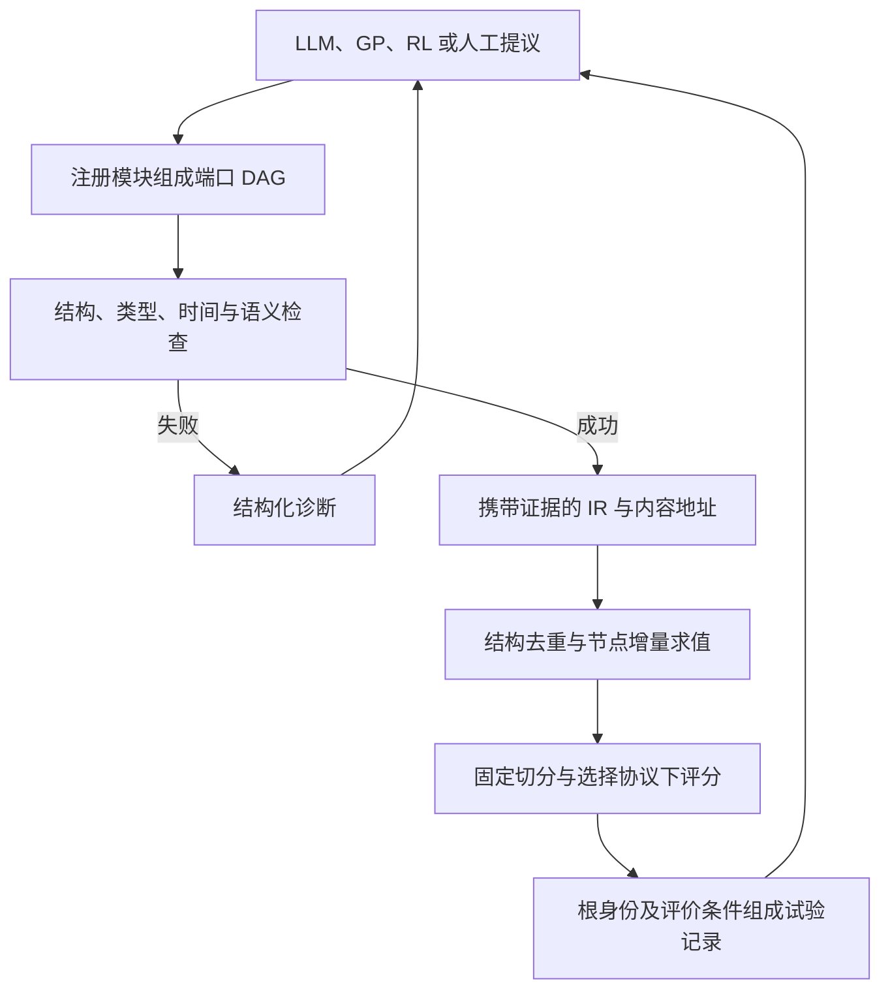

# QBX 论文解读

> - 速读卡：[QBX](../cards/2026_QBX.md)
> - 文献版本：[arXiv v1](https://arxiv.org/html/2610.41689v1)，2026-10-30；ICAIF 2026 作者预印本，正文第 1–7 节。

## 核心结论

QBX 以版本化模块注册表、类型化策略图和确定性编译器定义 alpha 程序的准入空间，在求值前检查结构、类型与时间可用性，并以内容身份连接增量计算、去重和试验记录。实验主要支持有效候选比例、契约可见前视的提前拒绝，以及部分计算复用收益。受限表示同时带来搜索广度的代价；它不为固定数据增加预测信息，也不直接提供多重检验校正或整策略扣费收益保证。

## 1. 研究背景与问题

公式因子挖掘方法不断改变候选生成方式，但候选表示、评价器和选择规则往往仍绑定在各自管线中。任意文本或表达式既可能无效，也可能含有难以从绩效上发现的前视；同一信号还可能以不同名称或写法反复出现（原文第 1 节）。

论文把这些问题归纳为三个环节：

| 环节 | 困难 | 对研究结果的影响 |
| --- | --- | --- |
| 准入 | 类型、引用、时间依赖等错误到执行时才暴露 | 历史评价承担了本可提前完成的检查 |
| 身份 | 同一程序存在不同写法，共享计算缺少稳定标识 | 重复求值、重复发现与试验计数混杂 |
| 选择 | 只报告赢家，缺少可追溯的试验分母 | 难以分析搜索多重性造成的乐观偏差 |

这些困难不都属于生成算法。作者因此将研究对象放在生成与评价之间的程序表示和准入机制，而不是再提出一种更强的候选提议模型。

## 2. 核心思路：由编译器定义可评价对象

自由文本到策略的映射是部分且多对一的：许多文本没有可执行含义，多种文本又可能指向同一程序。QBX 先用有限、版本化的注册表定义可引用模块，再将候选组织为带类型端口的有向无环图（DAG），由编译器决定其是否属于准入空间（原文第 3.1–3.3 节）。

图中的每个节点同时具有计算契约、时间可用性和内容地址。由此，合法性检查可以先于历史求值；节点身份可以支持共享计算；整个图的身份连同评价条件可以定义一次试验。三者使用同一个归一化对象，减少各环节独立解释候选造成的不一致（原文第 3.4 节）。

这里的设计取舍是受限性。封闭词表便于检查，但会限制可表达和可到达的候选；DAG 允许共享子计算，却不因此具有比可共享子树表示更强的表达能力。实验需要同时度量准入收益、成本及搜索广度，不能只报告合法率。

## 3. 方法设计

### 3.1 整体框架与准入空间

QBX 的三个阶段分别定义候选、编译候选和执行已准入对象：



注册表包含 95 个模块、261 条带类型端口声明和 13 种值类型表达式，模块覆盖信号、仓位、风险与执行，因而表示对象可包含完整策略，而不限于单一因子公式（原文表 1）。

令 R 为注册表、c 为编译器版本，定义 1 将准入条件写成：

```text
WF_{R,c}(G) = Complete(G) AND Bound_R(G) AND DAG(G) AND Typed_R(G)
              AND Causal_R(G) AND Semantic(G) AND Linked_R(G)
```

```text
S_{R,c} = {G: WF_{R,c}(G)}
```

这些条件分别要求图完整、模块引用属于注册表、无环、端口类型兼容、时间可用、语义边界合法且执行依赖可链接。编译器是到中间表示（IR）的部分函数：失败时返回诊断，成功时保留归一化图、拓扑调度、类型环境、可用性效应、地址和链接信息。下游使用这些证据，不重新解释原始文本（原文第 3.3 节、表 3）。

### 3.2 类型约束与闭合的图编辑

节点通过具名端口连接，输出类型须与目标输入匹配。一个生产者可以同时供给多个消费者，避免相同子计算在树中复制。类型检查主要约束局部接口，但合法重连还可能形成环，因此最终仍以整图编译为准。

搜索动作包括模块替换、参数修改、重连、插入/删除、克隆/共享、子图编辑及带类型的待填位置。每次提议后继图都经过编译，仅返回成功对象。命题 1 的闭合性由这一构造保证：从合法父图出发，提交的后继仍属于 S_{R,c}（原文表 2）。

该保证不等于动作完备，论文不主张任意合法图都能由当前动作到达；也不保证得到的数值信号非恒定、覆盖充足或具有预测能力。程序可执行与因子可评分仍是不同条件。

### 3.3 时间可用性效应

定义 2 为逻辑索引 t 上的值附加效应 φ，表示它相对 t 的可知时点：φ=0 表示当时可得，φ<0 表示此前已知，φ>0 表示当时尚不可得；无时间索引的字面量记为 ⊥。

| 运算 | 可用性传播 |
| --- | --- |
| 多输入汇合 | 对有时点输入取最大偏移 |
| 滞后 p | φ(lag_p(x))=φ(x)-p |
| 历史窗口 p>0 | φ(window_p(x))=φ(x) |
| 延迟 l | 汇合偏移加 l |
| 准入 | 每个实体化节点满足 φ≤0 或 ⊥ |

前视检查由此成为对时间依赖的静态传播，不必先计算市场面板。对于发布早于其索引的预测值，负偏移可以合法；判断依据是信息何时可知，而不只是索引是否处于未来（原文第 3.3 节）。

命题 2 的保证是相对于契约的非前视性：若数据源偏移确实上界真实发布时间，且每个注册算子的转移如实描述计算，则沿拓扑顺序可归纳证明已准入节点只依赖 t 时可得信息。错误的发布时间、历史成分或数据修订不由这项静态保证自动排除。

### 3.4 内容身份、重复层级与增量计算

定义 3 对节点的归一化计算语义、有效参数、输出类型、模块契约、父节点地址和端口做规范序列化并哈希，构成 Merkle 式内容地址。名称、位置等展示信息不进入身份。图根身份还绑定编译器与注册表版本（原文第 3.4 节）。

由此，重命名不改变地址；局部编辑只使其下游依赖锥的地址改变；结构相同的子计算可以复用。论文图 2 的例子中，收盘价先转收益，再分别计算均值和标准差，最后相除；将标准差窗口从 20 改为 60，只需重算标准差及除法节点，价格、收益和均值均可复用。

缓存键为：

```text
K(c,v) = H(cache version, context, a(v))
```

其中 a(v) 是节点地址，context 固定数据版本、股票池、区间和执行语义。命题 3 还要求节点及其祖先纯且确定、注册契约与实际计算一致、哈希碰撞可忽略；满足条件时，缓存命中等价于重新求值。共享结构只是复用的条件，完整上下文与确定性同样必要。

论文同时区分四种重复关系：

| 层级 | 可识别的重复 | 作用边界 |
| --- | --- | --- |
| 精确字符串 | 相同文本 | 只能发现直接重复提交 |
| 结构规范化 | 改名、顺序等规范化后相同 | 支持保守的结构身份与缓存 |
| 审计重写 | 满足语义条件的代数等价 | 可在求值前进一步合并，但依赖规则正确性 |
| 面板外延等价 | 在指定面板上数值相同 | 必须求值后识别，修正广度而不节省首次评价 |

这些关系不能互换。特别是 NaN/Inf 语义可能使 x*0→0 等普通代数规则失效；某个面板上的取值相等也不证明两个程序在其他数据上等价。

### 3.5 根身份与试验记录

一次试验不仅包含图根 a(G)，还包含注册表清单、编译器版本、切分、指标、选择器与提议者：

```text
r = (a(G), registry manifest, c, split, metric, selector, proposer)
```

命题 4 指出，若完整候选去重与记账使用同一身份，精确重复在计算与试验记录中具有一致的计数。节点缓存只节约新候选内部的计算，不会将该候选从试验数中删除；同一程序在不同评价条件下也仍可构成不同试验（原文第 3.4 节）。

账本为后续选择统计提供明确的计数对象，但内容不同的程序仍可能高度依赖。论文将完整统计利用留作后续工作，因此账本不是有效独立试验数估计，也不直接给出 deflated Sharpe、FDR 等校正结果。

## 4. 实验证据

### 4.1 设置与各类证据的职责

主要面板使用 BaoStock 前复权日频 OHLCV，以 CSI500 为主、部分使用 CSI300，标签为 20 日前向收益。训练至 2020-12-31 固定方向，验证 2021-01 至 2022-06 用于选择，测试自 2022-07 起；扩展面板截至 2026-05，采用当前成分快照（原文表 4、Evidence protocol）。

机制实验另用 2025 年 AAPL 小时数据与合成图，不能作为截面预测证据。LLM 候选来自冻结的 deepseek-chat 采样库；提示要求次日收益，与面板的 20 日评价期限不同。oracle 按测试窗选出，只作诊断上界，实际选择结果则须按验证期规则解释。

### 4.2 准入收益与前视检查

E6 在同一评估器、10 个种子、300 次迭代下比较表示与约束：

| 搜索表示 | 有效率 | 每次运行不同有效因子 | 累积到 20 个因子的迭代数 |
| --- | ---: | ---: | ---: |
| 自由字符串 | 26.8% | 7.1 | 未达到 |
| 文法约束 | 36.4% | 38.0 | 140±28 |
| 类型化树/DAG | 97.7% | 204.9 | 20.5±0.5 |

类型与效应检查解释了相对文法对照的大部分准入改善（表 5）。类型化树与 DAG 的搜索轨迹相同，DAG 的增量作用落在成本与身份，而不是额外的搜索质量。残余 2.3% 为数据相关求值失败，也表明静态准入不能保证信号可评分。

E2 中静态检查拒绝 6/6 个植入前视，而训练/测试切分对这些构造检出 0/6；扩展测试拒绝 10/10 个对抗性时间构造并接受 3/3 个因果对照。23,342 次准入中没有登记契约违规。该结果支持对契约可见前视的检查能力，分母是准入候选，不是独立经济发现，也不意味着所有数据泄漏均已消除。

### 4.3 身份与计算复用

E3 在 30,210 个到达候选上报告：精确字符串去重剔除原始 LLM 输出的 40.1%，但对准入后搜索输出的增量为零；审计重写在求值前进一步剔除 13.8%，面板外延重复则在求值后识别出 27.9%。别名使部分谱系的试验计数膨胀 1.2–1.64 倍。结果说明“重复率”必须同时注明候选阶段与等价层级。

表 7 的增量重放较全量重算快 7.50 倍，1,760 次比较无数值差异；内循环变异、检查与去重为每候选 56.7 μs，LLM 调用中位数为 1.45 s。不过，E6 中 memo 化减少 36.6% 节点求值却多耗时 16.9 s，廉价计算的管理开销可能超过复用收益。论文也未提供与 Qlib 或共享 AST 的匹配强基线，不能把全部加速归因于内容身份。

### 4.4 受限搜索的质量与广度代价

E13 比较相同 LLM 调用预算下的测试 RankICIR（3 个探索性种子）：

| 调用预算 | 仅类型化搜索 | 仅 LLM 提议 | 混合方式相对仅 LLM 的变化 |
| --- | ---: | ---: | ---: |
| 10 | 0.251 | 0.316 | +0.006，处于种子噪声内 |
| 20 | 0.283 | 0.321 | +0.036±0.011 |
| 40 | 0.236 | 0.343 | +0.038±0.010 |

仅类型化搜索的有效广度为 1.00–1.93，低于 LLM 的 4.65–9.38。结果支持提议广度与受约束局部搜索可能互补，同时明确了闭合空间的代价。更强字符串变异对照在部分预算下消除了类型化 oracle 优势，因此预测生成能力的主张比准入与检查的证据更弱（E9–E10）。

选择侧的生态位占用惩罚将篮子平均绝对相关从 0.740 降至 0.253，有效因子数从 1.66 升至 5.49，但最多弥补 36% 的 oracle–naive 差距（E14）。该机制基于已评价信号，与结构去重不同，也未证明合法搜索自然产生行为多样性。

E15 还将多种挖掘器的本地适配器接到统一评价器：Hubble 的 1,000 条输出对应 250 个规范身份，AlphaAgent 适配器有 33% 不可评分。由于适配器未做官方实现一致性检查、每臂只用一个冻结池，这些是测量机制的案例，不构成原方法排名；完整策略图的 QBX-native 臂也只用于对象覆盖说明。

## 5. 研究结论

QBX 的主要贡献是将可检查的候选空间、可复用的计算身份和可追溯的试验条件连接起来。实验对准入、检查时点和部分成本收益提供了证据，也表明结构正确并不保证预测能力或因子多样性。对因子挖掘更普遍的启示是分别定义合法性、计算相同、信号相同和统计试验，避免用单一“去重”概念替代这些不同问题。

### 局限与未披露

1. **保证条件**：时间契约、数据发布时间、内核纯度与完整上下文是可信假设；不规则时间戳、修订、事后成分和 as-of 连接仍在静态检查之外。当前成分快照也限制面板结果的历史可交易性解释。
2. **表示代价**：注册表受限、动作完备性不被主张，部分动作仍是原型；尚无公开公式库的可表示性普查，类型化池存在行为集中现象。
3. **证据范围**：主要预测证据来自中国 A 股、单一 20 日期限和未扣费截面统计；整策略是表示与准入能力，未得到相应交易收益评估。多个关键扩展只有三个种子，属于探索性结果。
4. **机制披露**：完整注册表、类型词表、块级时间转移、规范序列化与生态位选择公式未列齐；内部预注册规则和冻结池未公开，限制独立复核。求值前重写等价如何与精确试验身份衔接，也缺少完整规则。
5. **统计边界**：试验账本提供计数接口，尚未完成考虑相关性、重叠期限与自适应搜索的统计校正；零契约违规或正确去重均不等于错误发现率已受控。

### 针对的问题

- **P1（主要）**：编译准入与闭合动作减少无效候选进入历史评价。
- **P6（主要）**：时间可用性效应在求值前拒绝契约可见前视。
- **P10（主要）**：IR、根身份和评价清单固定候选及其试验条件。
- **P2、P3、P5、P7（涉及）**：分别对应受限表示、增量复用、试验记账，以及不同层级的重复与行为冗余。
